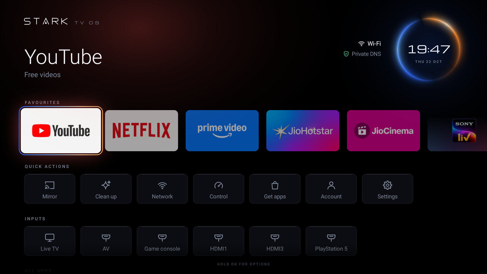
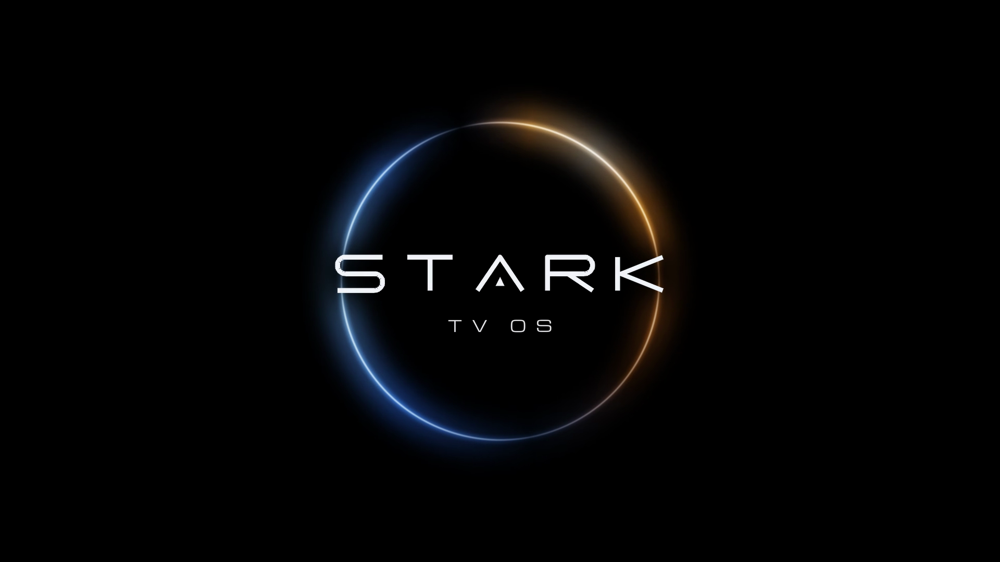
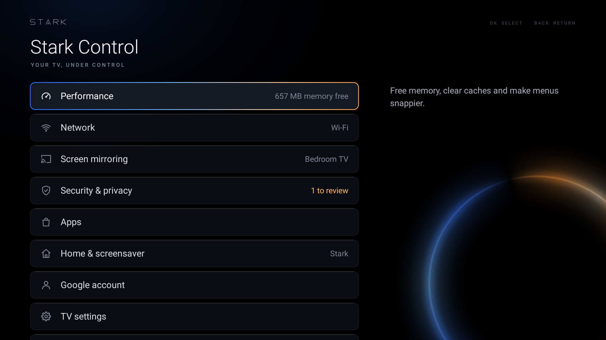

# Stark-TV-OS

**A fast, minimal home for old Android TVs.** It replaces the laggy stock launcher, turns off the TV maker's
promo and telemetry apps, and adds a Control Center for cleaning, network, encrypted DNS, screen mirroring and
security, while keeping the Play Store, Google sign-in, Chromecast and every streaming app working.

No root. Nothing uninstalled. One command (`./stark restore`) puts the TV back exactly as it was.

[](docs/walkthrough.mp4)

*Recorded on the TV in real time, not sped up: a 2 GB TCL on Android TV 9. [MP4 version](docs/walkthrough.mp4).*

**[Download the APK](https://github.com/tonystark-ez/Stark-TV-OS/releases/latest)** · [Install](#install) ·
[Build from source](#option-b-build-from-source)

## The look

"Eclipse": pure black, one ice-blue to amber light, wide geometric type. The focused app's name and a line about it
sit large at the top, the clock lives inside the eclipse ring, and a soft light behind the header takes the colour of
whatever you're on (red for YouTube, blue for Prime Video). The Stark-TV-OS animation plays when the TV turns on.

Every glow is rendered **once** into a bitmap on a background thread, so the look costs nothing per frame.



| Startup | Stark Control |
|---|---|
|  |  |

## Why it's fast

Measured on a TCL BeyondTV (Android TV 9, Realtek RTD285O, 4x Cortex-A55, 2 GB RAM), before and after:

| | Stock | Stark-TV-OS |
|---|---|---|
| Janky frames while navigating | 64% | 0-8% |
| 90th percentile frame time | 89 ms | 11-15 ms |
| Home screen memory | 98 MB | 25 MB |
| Free system memory | ~560 MB | ~685 MB |
| APK size | | ~270 KB (incl. font and startup animation) |

How:

- **One hand-drawn Canvas** for the whole home screen: no layouts, no RecyclerView, no libraries. It only redraws
  while something moves and allocates nothing per frame.
- **No live effects old GPUs choke on**: no blur, shadows or clip paths at draw time. Glows are pre-rendered
  alpha bitmaps tinted by the paint colour. Text and icons never change size while animating (re-rasterizing
  glyphs every frame is what stutters on these chips).
- **Tiles pre-rendered once** at their exact on-screen pixel size, rounded, on a background thread.
  When a streaming app is in front and memory runs low, the launcher hands its images back to the system.
- **No network at all on the home screen.** No recommendations, no weather, no tracking.
- **The real culprit on old TVs is memory**, not the launcher alone: 2 GB TVs swap to slow eMMC all day.
  `./stark debloat` turns off what doesn't need to run (TCL analytics, promos, store demo, Ambient Mode, dead
  Google apps), and Control Center closes background apps and clears caches on demand.

## What you get

**Home**: favourites (your installed streaming apps, auto-sorted for India: YouTube, Netflix, Prime Video,
JioHotstar, JioCinema, SonyLIV, ZEE5, ...), Quick actions, HDMI/AV inputs with their names, all apps, and
suggestions for popular apps you don't have yet (they open in the Play Store). Long-press OK (or Menu) on an app:
add to or remove from favourites, reorder, app info, uninstall.

**Stark Control**:

- **Performance**: one-press clean up, free memory, clear app caches, biggest caches per app, animation speed, storage.
- **Network**: connection, signal, band (warns on crowded 2.4 GHz), speed test, **encrypted DNS** (Cloudflare,
  AdGuard with ad/tracker blocking, Quad9 with malware blocking, Google; if your network blocks it, Stark falls
  back to automatic on its own), IP/router/DNS, refresh connection.
- **Screen mirroring**: Chromecast built-in, Miracast (Android phones, Windows Win+K), TCL T-Cast, AirPlay via
  AirScreen for iPhone and Mac, with how-to for each.
- **Security & privacy**: ADB status and one-press off, encrypted DNS, security patch age, apps from outside the
  Play Store, install-unknown-apps settings, what `./stark` turned off, ad personalisation.
- **Apps**: popular Indian apps (installed or get), Play Store, suggestions on/off, reset favourites.
- **Home & screensaver**: Stark Clock screensaver (dim ring and clock, moves every minute, no downloads),
  startup animation (start and wake / start only / off, plus a preview), original home.
- **Google account** (TV's own sign-in), **TV settings**, **About this TV**.

**Startup animation**: Android's own boot animation lives on the read-only system partition, which can't be changed
without root. So Stark plays it as the home screen appears: after a real boot (detected by Android's boot counter)
and, because TCL TVs mostly *suspend* rather than shut down, when the TV wakes from standby (detected by the time the
system spent suspended). It's a 4-second silent 1080p clip decoded in hardware; any button skips it, and a timeout
guarantees it never hides the home screen. If the TV wakes into another app, it doesn't play.

The clip is generated, not hand-edited: `python3 tools/render_boot.py` (numpy, Pillow, ffmpeg) renders it frame by
frame from the same ring colours and lettering the home screen uses.

## Why not a custom ROM?

Because you'd lose what makes the TV useful. TCL bootloaders are locked, and a replacement system image loses
Google certification and Widevine L1 DRM: Netflix, Prime Video and JioHotstar then refuse to install or drop to SD,
and Google sign-in breaks. Stark-TV-OS keeps the certified system underneath and replaces everything you see and
everything that slows it down.

## Install

Two ways in. **Option A** installs the ready-made APK from GitHub Releases and needs only `adb`. **Option B**
builds it from the source, for when you want to change something first.

Either way, start on the TV: Settings > Device Preferences > About > click *Build* 7 times, then Developer options >
*USB debugging* on. Note the TV's IP address (Settings > Network). Your computer must be on the same Wi-Fi.

### Option A: install the release APK

1. **Get adb**: `brew install --cask android-platform-tools` (macOS), `sudo apt install adb` (Debian/Ubuntu) or
   `winget install Google.PlatformTools` (Windows).
2. **Download** `StarkTV.apk` and *Source code (zip)* from the
   [latest release](https://github.com/tonystark-ez/Stark-TV-OS/releases/latest), and unzip the source.
3. **Check the download** (optional, recommended). The SHA-256 must match the one in the release notes. If you
   have Android build-tools, the signer must be `CN=Stark-TV-OS` with certificate SHA-256
   `6cc128888741ce25c620fc487f8ac92fff6a61ea0b9528dced4caa507a54a11f`:

   ```bash
   shasum -a 256 StarkTV.apk
   apksigner verify --print-certs StarkTV.apk
   ```

4. **Install** from the unzipped folder (macOS, Linux, or WSL/Git Bash on Windows). This is the same guided setup
   as building from source, without any build tools:

   ```bash
   ./stark connect 192.168.1.20                  # accept "Allow USB debugging?" on the TV, tick Always allow
   ./stark install --apk ~/Downloads/StarkTV.apk # installs, makes it home, offers tune + debloat
   ./stark lock                                  # when done: turns ADB off on the TV
   ```

<details>
<summary>Prefer plain adb commands, without the script?</summary>

```bash
adb connect 192.168.1.20:5555
adb install -r StarkTV.apk
adb shell pm grant io.github.starktvos android.permission.WRITE_SECURE_SETTINGS   # encrypted DNS, animations, screensaver
adb shell appops set io.github.starktvos GET_USAGE_STATS allow                    # cache sizes
adb shell cmd package set-home-activity io.github.starktvos/.HomeActivity
```

If Home still opens the TV's own launcher, it outranks other home screens; turn it off (and its recommendations
service, which crashes without it):

```bash
adb shell pm disable-user --user 0 com.google.android.tvlauncher
adb shell pm disable-user --user 0 com.google.android.tvrecommendations
```

To undo: `adb shell pm enable` both of them, then `adb uninstall io.github.starktvos`. Finish with
`adb shell settings put global adb_enabled 0` to turn debugging off. The script does all of this, records it, and
skips the debloat and tune steps unless you say yes.
</details>

Without a computer you can still sideload the APK (USB stick and a file manager) and open Stark from the app list,
but Android TV won't let an app make itself the home screen or grant the settings permission without adb.

### Option B: build from source

1. **Tools** (`./stark doctor` checks them). On macOS:

   ```bash
   brew install openjdk@17 && brew install --cask android-commandlinetools android-platform-tools
   sdkmanager --sdk_root=/opt/homebrew/share/android-commandlinetools "build-tools;34.0.0" "platforms;android-34"
   ```

   On Linux: JDK 17, the Android command-line tools and `adb`, then the same `sdkmanager` line with your SDK
   path (set `ANDROID_HOME` to it).

2. **Clone, change, build, install**:

   ```bash
   git clone https://github.com/tonystark-ez/Stark-TV-OS.git && cd Stark-TV-OS
   # edit app/src/io/github/starktvos/*.java, profiles/*.txt, ...
   ./build.sh                      # StarkTV.apk; the first build creates your own signing key in .stark/
   ./stark connect 192.168.1.20
   ./stark scan                    # read-only: model, memory, what's slowing it down
   ./stark install                 # rebuilds if the source changed, installs, makes it home, offers tune + debloat
   ./stark validate                # static and on-TV test suite, before you share a build
   ./stark lock
   ```

Your build is signed with your own key, so Android won't install it over the release APK (or the other way
round). Run `./stark uninstall` first; favourites are reset. Keep `.stark/` safe: every update you ship must be
signed with the same key.

To re-render the media: `python3 tools/render_boot.py` (startup animation; numpy, Pillow, ffmpeg) and
`tools/record_walkthrough.sh <tv-ip>` (this README's walkthrough, recorded on the TV).

On macOS, if `adb connect` says *No route to host* while the TV is on, allow your terminal under System Settings >
Privacy & Security > Local Network.

## Commands

| Command | What it does |
|---|---|
| `./stark scan` | Specs, memory hogs, promo apps found. Changes nothing. |
| `./stark install [--apk FILE]` | Install (a release APK, or build from source), grant the settings Stark manages, make it home, offer tune and debloat |
| `./stark tune` | Animations 0.5x, Stark Clock screensaver |
| `./stark debloat [--dry-run] [--assistant]` | Turn off promo/telemetry apps (`--assistant`: also voice search, saves ~80 MB and constant CPU) |
| `./stark clean` | Trim every app cache, close background apps |
| `./stark status` | What's changed, memory, Stark's own footprint |
| `./stark home` | Make Stark the home screen again |
| `./stark restore` | Undo everything |
| `./stark lock` | Turn off ADB on the TV |
| `./stark shot` / `logs` | Screenshot into `shots/`, follow the log |
| `./stark validate [--static]` | Run the test suite (below) |

## Validation

`tests/validate.sh` (or `./stark validate`) is the release gate. `--static` needs no TV and is what CI should run.

- **Static**: script syntax and shellcheck; the CLI must refuse injected input; the APK builds under a 1 MB budget;
  the signing certificate is ECDSA P-256 with SHA-256, unexpired, and matches the project key; the manifest is not
  debuggable, has backups and cleartext traffic off, exactly the reviewed permissions, and every exported component
  is either a launcher entry or permission-protected; no credentials, private keys or certificates in any file that
  would be published; no weak crypto, WebView bridges, custom TLS trust, `exec` or dynamic code loading; no `http://`.
- **On the TV**: upgrade install, permissions, Home resolution, cold start time, every tile rendered, jank and
  90th-percentile frame time while navigating, memory, long-press menu (volume keys must still work), the startup
  animation (plays, ends, any key skips it without opening an app), every Control Center page, apps disappearing
  and reappearing when disabled and re-enabled, 1500 random remote presses (monkey) without a crash or freeze, and
  recovery after a force-stop. Settings are snapshotted before and compared after: the suite must leave no trace.
  While a monkey test runs, Stark refuses every action that changes the TV (`ActivityManager.isUserAMonkey()`).
- `--reboot` also reboots the TV and checks the animation plays on boot; `--restore-cycle` runs `./stark restore`,
  checks the TV is stock again, then reinstalls Stark.

If Stark crashes three times within ten minutes it starts in safe mode (no animation, art or tile images) until it
has run cleanly for a minute.

## Safety

- Apps are only ever **disabled** (`pm disable-user`), never uninstalled or cleared, and every one is recorded in
  `.stark/state/` so `./stark restore` re-enables it.
- `profiles/protected.txt` lists what is never touched: Play Store, Play services, Chromecast, remote, keyboard,
  inputs, tuner, picture/sound, setup, updates, Miracast/T-Cast/AirPlay. Checked before every change.
- Apps that saved a Wi-Fi network are never disabled (Android would erase the network).
- The stock launcher declares a higher home priority than any installed app may have, so it is turned off while
  Stark is home (and its recommendation service with it). `./stark restore` brings both back.
- The only permissions granted over ADB are `WRITE_SECURE_SETTINGS` (encrypted DNS, animations, screensaver, ADB
  off) and usage access (cache sizes). The state receiver only accepts broadcasts from holders of
  `WRITE_SECURE_SETTINGS`, i.e. the ADB shell. No cleartext traffic, no backups, no analytics.

## Adapting it to another TV

Run `./stark scan`, then edit `profiles/debloat.txt` (promo, demo and telemetry apps only, one comment each) and
`profiles/protected.txt` (anything the TV needs: when in doubt, protect it). Add regional apps to `Catalog.java`.

## Project layout

| Path | What it is |
|---|---|
| `stark` | The CLI: install, tune, debloat, clean, restore |
| `build.sh` | aapt2 > javac > d8 > zipalign > apksigner; no Gradle |
| `profiles/` | Debloat, assistant and protected package lists |
| `tests/validate.sh` | Static and on-TV validation suite |
| `app/src/.../HomeView.java` | The home screen (one Canvas) |
| `app/src/.../HomeActivity.java` | Apps, inputs, clock, network status, long-press menu, startup animation trigger |
| `app/src/.../Art.java`, `Theme.java` | Pre-rendered eclipse ring and glows, the STARK wordmark, colours and type |
| `app/src/.../SplashView.java` | Startup animation (`app/res/raw/stark_boot.mp4`) |
| `tools/render_boot.py` | Renders the startup animation |
| `tools/record_walkthrough.sh`, `walkthrough.sh` | Records the README walkthrough on the TV |
| `app/src/.../StarkApp.java` | Font loading, crash counter for safe mode |
| `app/src/.../CenterActivity.java`, `PanelView.java` | Stark Control |
| `app/src/.../SystemTools.java`, `NetTools.java` | Memory, caches, settings; network, speed test, DNS |
| `app/src/.../Catalog.java` | Popular apps in India and default favourites |
| `app/src/.../ClockDream.java` | Stark Clock screensaver |

Keep `.stark/release.keystore` (and its generated password file next to it): updates must be signed with the same
key. Both are git-ignored.

## Credits

Inspired by [Free My TV](https://github.com/simbasjungles/free-my-tv) (MIT), which showed that a hand-drawn launcher
plus careful debloating makes old Google TVs fast again. Stark-TV-OS is an independent implementation.
Not affiliated with TCL, Google or any streaming service.

[Michroma](https://fonts.google.com/specimen/Michroma) by Vernon Adams, SIL Open Font License 1.1
(`app/assets/fonts/OFL.txt`).

## License

MIT
